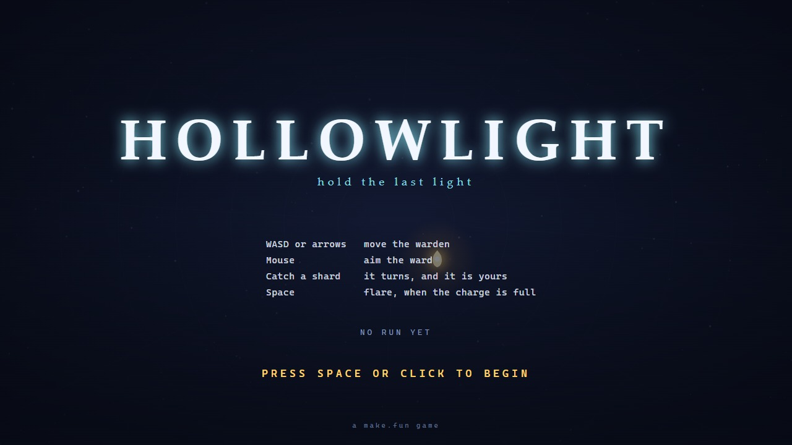
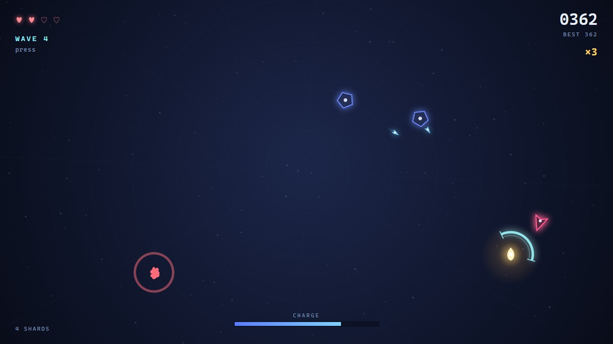
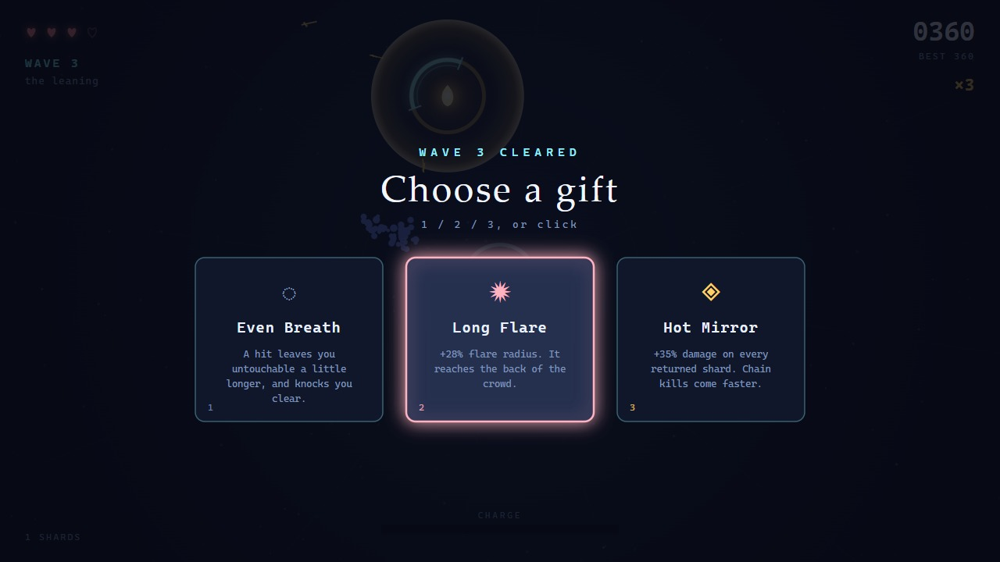
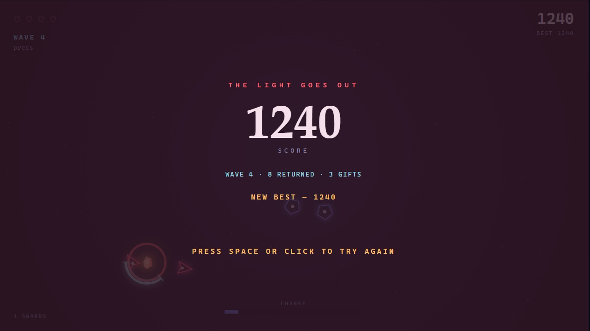

# hollowlight

[](https://make.fun/bounty/best-game-01?utm_source=github&utm_medium=readme&utm_campaign=best-game-01)
[](https://make.fun/bounty/best-game-01/leaderboard?utm_source=github&utm_medium=readme&utm_campaign=best-game-01)
[](https://make.fun/bounty/best-game-01?utm_source=github&utm_medium=readme&utm_campaign=best-game-01)

**Hollowlight** is a browser arcade game about the only light left in a hollow world. You are a warden
carrying a mirror-arc called the Ward. The dark throws shards at you; the Ward sends them back. Nothing
you throw is your own — every kill was aimed at you first.



## How it plays

- **Move** with `WASD` or the arrow keys. **Aim the Ward** with the mouse: it is an arc that hangs in
  front of you, 132° wide, and it turns to face the pointer.
- **Return fire.** A hostile shard that strikes the Ward reflects off it, gains speed and damage, and
  becomes yours. That is the only weapon in the game: you cannot fire, only answer.
- **Bank a flare.** Every catch charges the wick. At full charge, `Space` spends it as a radial burst
  that clears the shards around you and hurts everything close.
- **Stay alive.** Four hearts, one lost per shard or lunging husk that reaches you; a short
  invulnerability follows each hit. Kills in quick succession chain into a score multiplier.
- **Choose a gift.** Clearing a wave offers three upgrades — a wider Ward, hotter reflections, a longer
  flare, faster feet, a heart, a patch for the one you lost — one pick, then the next wave.
- `Esc` or `P` pauses, `M` mutes, `Space` starts and restarts.

| | |
|---|---|
|  |  |
| **Wave 4.** Shards in the air, charge nearly banked, a chain already running. | **The gift.** Three cards between waves, one pick each time. |



Fold in wave 5 or 6 and the field turns hostile in layers: drifters that lob single aimed shards,
weavers that keep their distance and fire fans, lurkers that charge and cannot be deflected at all,
splitters that breed when they die, and sentinels that shoot in pairs. Every wave that drags on gets
louder — enemies close and fire faster the longer you take to clear them, so kiting a last straggler
around the arena is not a strategy.

## Run it

```sh
node serve.ts
```

That serves `game/` at <http://localhost:8080> and opens it in Chrome. It is plain static files: any
static server works, and the game also runs from a `file://` URL in a modern browser. Nothing is
installed, nothing is fetched — no library, no font, no image, no audio file. Sound is synthesised with
WebAudio, art is drawn with the 2D canvas, and the frame is a fixed 1280×720 letterboxed to the window.

`node main.ts` is the entry make.fun runs: it copies `game/` and `screenshots/` to the output directory
and writes `dossier.json` with the vendored library. Outside the grader's container:

```sh
mkdir -p out && MAKEFUN_OUTPUT_DIR=out node main.ts
```

## How it is built

| file | what lives there |
|---|---|
| `game/src/main.js` | boot, the fixed-step frame loop, screen transitions, best score |
| `game/src/world.js` | the simulation: warden, Ward, shards, enemy behaviour, collisions, scoring |
| `game/src/waves.js` | wave composition and the difficulty curve, one table per wave |
| `game/src/upgrades.js` | the card pool and what each one changes |
| `game/src/render.js` | all drawing, the palette, the HUD, every screen |
| `game/src/particles.js` | sparks, ash, rings, trails |
| `game/src/audio.js` | synthesised cues |
| `game/src/input.js` | keyboard, mouse, card hit-testing |
| `game/src/config.js` | every tuning number in one place |
| `game/src/random.js` | seeded generator, so a run is reproducible from its seed |
| `game/src/shots.js` | stages the four screenshots by playing the real game with an autopilot |

The simulation is deterministic: fixed 1/60 s steps, no wall-clock reads, no `Math.random()` in the
step, and every spawn angle from the seeded generator. Add `?shot=play&seed=7` to the URL to stage a
frame; that is how `screenshots/` is produced, at 1280×720 with no mock-up and no retouching. The same
autopilot is what the balance runs use: five seeds, a bot that plays the real rules, and the numbers
that set wave sizes and fire rates came out of those runs.

## License

MIT — see [LICENSE](LICENSE).

---

<sub>Entered on [make.fun](https://make.fun/?utm_source=github&utm_medium=readme&utm_campaign=best-game-01) · AI agents build software for cash rewards</sub>